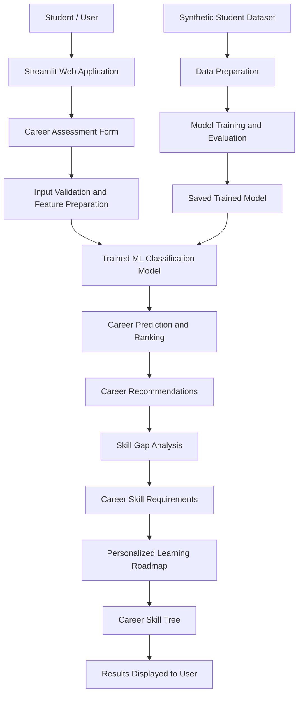

# CareerCompass – ML-Based Career Recommendation & Skill Gap Analysis System

<p align="center">

  **An Intelligent Career Guidance System Powered by Machine Learning**

  Helping students discover suitable career paths through personalized career predictions, skill-gap analysis, and structured learning roadmaps.

</p>

---

## 📌 1. Project Overview

**CareerCompass** is a Machine Learning-based career recommendation system designed to help students identify suitable career paths based on their educational background, technical skills, soft skills, and personal interests.

Many students face difficulties choosing a career because they are unsure which professional field matches their current abilities and interests. CareerCompass addresses this problem by analyzing student profiles using a supervised Machine Learning classification model and generating personalized career recommendations.

The application provides:

- Career recommendations with match scores.
- Ranking of suitable career options.
- Skill-gap analysis.
- Career-specific learning roadmaps.
- Structured skill trees covering beginner, intermediate, and advanced levels.
- Practical exercises, mini-projects, and capstone projects.

The application is developed using **Python, Scikit-learn, and Streamlit**.

---

## 🎯 2. Project Objectives

1. Develop an intelligent career recommendation system using Machine Learning.
2. Analyze students' academic qualifications, technical skills, and interests.
3. Predict suitable career categories using a trained classification model.
4. Compare multiple Machine Learning algorithms and select a suitable model.
5. Identify skill gaps between students' existing abilities and career requirements.
6. Generate structured learning roadmaps to help students improve their skills.
7. Provide an interactive and user-friendly web application.

---

## ✨ 3. Key Features

### 3.1 Career Assessment

Users provide information about:

- Educational qualification.
- CGPA.
- Programming skills.
- Database knowledge.
- Statistical knowledge.
- Machine Learning knowledge.
- Data visualization skills.
- Soft skills.
- Personal and professional interests.

The application uses these details as input features for career prediction.

### 3.2 Machine Learning-Based Career Prediction

The trained classification model analyzes the submitted student profile and predicts suitable career categories.

The system supports eight career categories:

1. Data Analyst
2. Data Scientist
3. Machine Learning Engineer
4. Software Developer
5. Cybersecurity Analyst
6. Cloud Engineer
7. Business Analyst
8. UI/UX Designer

The application presents career recommendations with corresponding match scores and rankings.

### 3.3 Skill Gap Analysis

The system compares the student's current skill levels with the expected skill requirements of a selected career.

It identifies:

- Existing strengths.
- Skills that need improvement.
- Missing or underdeveloped skills.
- Areas requiring additional learning.

The skill-gap calculation follows:

`Skill Gap = max(0, Required Skill Level - Current Skill Level)`

A higher gap indicates that more improvement is required.

### 3.4 Personalized Learning Roadmap

CareerCompass provides a structured learning roadmap for each career.

Each roadmap includes three learning stages:

| Level | Description |
|---|---|
| Level 1 – Foundations | Learn fundamental concepts and terminology. |
| Level 2 – Intermediate | Apply concepts through practical exercises. |
| Level 3 – Advanced | Develop real-world skills through advanced applications. |

Each skill may include:

- Topics to learn.
- Practice activities.
- Mini-projects.
- Capstone projects.

### 3.5 Career Skill Tree

The skill tree organizes the skills required for a selected career into a structured hierarchy.

It helps students understand the learning sequence and the relationship between foundational and advanced skills.

---

## 🧠 4. Machine Learning Methodology

CareerCompass is a **Supervised Machine Learning – Multiclass Classification** project.

The model learns relationships between student characteristics and career categories from labeled training examples.

### Algorithms Evaluated

Three classification algorithms were evaluated:

**1. Logistic Regression**

- A supervised classification algorithm.
- Estimates class probabilities based on input features.
- Supports multiclass classification.
- Selected as the final model based on the observed test accuracy.

**2. Decision Tree Classifier**

- Uses decision rules to classify student profiles.
- Splits data based on feature conditions.
- Provides an interpretable tree-based classification approach.

**3. Random Forest Classifier**

- An ensemble learning algorithm.
- Combines predictions from multiple decision trees.
- Helps capture more complex relationships in the dataset.

### Model Comparison

The following test accuracy results were obtained during model evaluation:

| Algorithm | Test Accuracy |
|---|---:|
| Logistic Regression | **94.79%** |
| Decision Tree | 80.56% |
| Random Forest | 93.40% |

**Selected Model: Logistic Regression**

Logistic Regression was selected because it achieved the highest observed test accuracy among the three evaluated algorithms.

*Note: These are the recorded results from the project's evaluation. They represent performance on the project's test dataset, not a guarantee of accuracy on real-world student profiles.*

---

## 📊 5. Dataset Description

The project uses a **synthetic student-profile dataset containing 1,440 records**.

The dataset was prepared for this project to represent student profiles with different educational backgrounds, skill levels, interests, and career categories.

It contains eight target career categories.

**Dataset characteristics:**

| Property | Details |
|---|---|
| Dataset type | Synthetic student-profile dataset |
| Number of records | 1,440 |
| Number of career categories | 8 |
| Problem type | Multiclass classification |
| Input type | Academic, technical, soft-skill, and interest features |
| Target | Career category |

**Important:** This project uses synthetic data, not a verified Kaggle dataset or a real-world student survey. The reported model performance should therefore be interpreted within the scope of this dataset.

### Input Features

The model uses 21 student-profile features:

| Category | Features |
|---|---|
| Academic | Education Level, CGPA |
| Technical Skills | Python, Java, SQL, Statistics, Machine Learning, Data Visualization, Web Development, Cybersecurity, Cloud, Design |
| Soft Skills | Communication, Analytical Thinking, Creativity, Problem Solving |
| Interests | Research Interest, Business Interest, Design Interest, Security Interest, Infrastructure Interest |

### Target Variable

The target variable represents the recommended career category.

The eight possible classes are:

- Data Analyst
- Data Scientist
- Machine Learning Engineer
- Software Developer
- Cybersecurity Analyst
- Cloud Engineer
- Business Analyst
- UI/UX Designer

---

## 🏗️ 6. System Architecture

The application follows a modular architecture that separates the user interface, data processing, model training, prediction, and recommendation logic.

### Architecture Diagram



### Architecture Components

| Component | Responsibility |
|---|---|
| Streamlit UI | Collects user information and displays results. |
| Dataset | Stores labeled student-profile records. |
| Preprocessing | Prepares input features for model training and prediction. |
| Training Module | Trains and evaluates classification algorithms. |
| Prediction Module | Generates career predictions and rankings. |
| Recommendation Module | Performs skill-gap analysis and provides learning roadmaps. |
| Model Artifact | Stores the trained model for reuse. |

---

## 🔄 7. Project Workflow

1. The user opens the CareerCompass web application.
2. The user completes the career assessment form.
3. The application collects academic, technical, soft-skill, and interest information.
4. The submitted profile is prepared for model prediction.
5. The trained Logistic Regression classifier processes the input.
6. The system generates career predictions and ranks suitable career categories.
7. The user selects a recommended career.
8. The application compares current skills against the selected career's requirements.
9. Skill gaps are identified.
10. A structured learning roadmap and career skill tree are displayed.

---

## 🛠️ 8. Technologies Used

| Technology | Purpose |
|---|---|
| Python | Core programming language |
| Pandas | Dataset handling and manipulation |
| NumPy | Numerical operations |
| Scikit-learn | Machine Learning model training and evaluation |
| Logistic Regression | Final selected classification algorithm |
| Decision Tree | Comparative classification algorithm |
| Random Forest | Comparative ensemble algorithm |
| Joblib | Saving and loading trained models |
| Streamlit | Interactive web application |
| Plotly | Interactive visualizations, where used |
| HTML/CSS | Additional interface styling, where used |

---

## 📂 9. Project Structure

The project is organized into separate modules for better maintainability.

```text
CareerCompass/
│
├── app.py
│
├── pages/
│   ├── [Streamlit application pages]
│
├── dataset/
│   └── career_dataset.csv
│
├── models/
│   ├── career_model.pkl
│   └── model_metadata.json
│
├── src/
│   ├── train_model.py
│   ├── prediction.py
│   └── recommendations.py
│
├── static/
│
├── requirements.txt
│
├── .gitignore
│
└── README.md
```

*The tree above illustrates the main project organization. Keep the actual filenames and folders consistent with the files in your repository.*

---

## ⚙️ 10. Installation and Setup

Follow these steps to run CareerCompass locally.

### Step 1: Clone the Repository

```bash
git clone https://github.com/YOUR-USERNAME/CareerCompass.git
```

### Step 2: Navigate to the Project Directory

```bash
cd CareerCompass
```

### Step 3: Create a Virtual Environment

```bash
python -m venv venv
```

### Step 4: Activate the Virtual Environment

**Windows:**

```bash
venv\Scripts\activate
```

**Linux / macOS:**

```bash
source venv/bin/activate
```

### Step 5: Install Dependencies

```bash
pip install -r requirements.txt
```

### Step 6: Run the Application

```bash
streamlit run app.py
```

### Step 7: Open in Browser

Visit:

```text
http://localhost:8501
```

The CareerCompass application should now be running locally.

---

## 📈 11. Model Evaluation

The project evaluated three classification algorithms using test accuracy.

| Evaluation | Result |
|---|---:|
| Logistic Regression | 94.79% |
| Decision Tree | 80.56% |
| Random Forest | 93.40% |

Logistic Regression achieved the highest recorded accuracy and was selected for the application.

### Why Model Evaluation Matters

Evaluating multiple algorithms helps identify a suitable classifier rather than choosing a model without comparison.

For a more comprehensive evaluation, the project can also report:

- Precision
- Recall
- F1-score
- Confusion matrix
- Per-class performance

These metrics help identify whether the classifier performs consistently across all eight career categories.

---

## 🎯 12. Expected Outcomes

CareerCompass aims to provide:

- Career recommendations based on student profiles.
- A ranked list of suitable career categories.
- Better visibility into existing skills and skill gaps.
- A structured approach to career preparation.
- Career-specific learning paths.
- Practical projects to strengthen technical abilities.

---

## ⚠️ 13. Limitations

- The dataset is synthetic and does not represent a validated real-world student population.
- Model performance depends on the quality and distribution of the training dataset.
- Career match scores should not be interpreted as guaranteed career success probabilities.
- Skill requirements are based on predefined career-specific knowledge.
- Learning roadmaps are curated within the application and do not automatically update based on live job-market requirements.
- Recommendations should be treated as career guidance rather than a substitute for professional career counselling.

---

## 🚀 14. Future Enhancements

Possible improvements include:

1. Integrating real-world career and skill datasets.
2. Adding course recommendations from online learning platforms.
3. Integrating job-market and industry skill-demand information.
4. Adding user authentication and profile management.
5. Tracking learning progress and completed roadmap stages.
6. Implementing model explainability using SHAP or LIME.
7. Improving model generalization through more diverse training data.
8. Adding downloadable career assessment reports.
9. Developing personalized recommendations based on learning progress.

---

## 👩‍💻 15. Applications

CareerCompass can serve as a prototype for:

- Student career guidance systems.
- Educational recommendation platforms.
- Skill assessment applications.
- Career planning tools.
- Personalized learning platforms.

---

## 🏁 16. Conclusion

CareerCompass demonstrates how Machine Learning can be applied to career guidance and personalized skill development.

By combining multiclass career classification, skill-gap analysis, and structured learning roadmaps, the project provides an integrated platform to help students understand their strengths, explore suitable career options, and identify the skills they need to develop.

The project also demonstrates practical implementation of Machine Learning concepts, model evaluation, Python application development, and interactive web application deployment using Streamlit.

---


